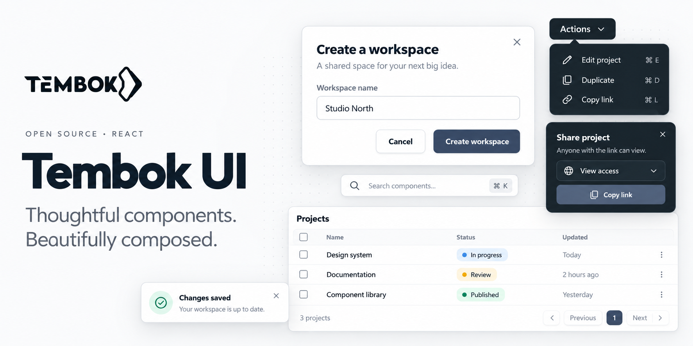

# Tembok UI

**Thoughtful components. Beautifully composed.**

A practical, open-source React UI kit with polished defaults and the flexibility to make every interface your own. Build dialogs, menus, notifications, tables, and forms without starting from scratch.



[React package on npm](https://www.npmjs.com/package/@tembok/ui-react) · [Component guide](./packages/ui-react/README.md) · [Changelog](./packages/ui-react/CHANGELOG.md) · [Issues & ideas](https://github.com/tembok-dev/tembok-ui/issues)

## Why Tembok UI?

Tembok provides **ready-to-use, styled components**, with behavior and appearance you can adapt to your product.

- **Thoughtful defaults.** Practical layouts, subtle visual details, keyboard interaction, and accessible patterns.
- **Your colors, your product.** Use semantic CSS variables for theme, contrast, and surface customization—including portaled overlays.
- **No Tailwind required for React.** The React package ships its component styles; you don't need a CSS utility framework or another UI component library.
- **Built for React and TypeScript.** Component props, IntelliSense descriptions, and familiar controlled-state patterns.
- **Light and dark.** Theme components locally or from your app root.

*Tembok is a styled component library with flexible, composable APIs—not an unstyled/headless-only kit. React and React DOM are peer dependencies.*

## Get started

Install the React package into an existing React 18 or 19 project:

```bash
pnpm add @tembok/ui-react
# or: npm install @tembok/ui-react
```

Use a component immediately:

```tsx
import { useState } from 'react';
import { Button, Modal, ToastProvider, useToast } from '@tembok/ui-react';

function Demo() {
  const [open, setOpen] = useState(false);
  const { show } = useToast();

  return (
    <>
      <Button onClick={() => setOpen(true)}>Create workspace</Button>
      <Modal
        open={open}
        onOpenChange={setOpen}
        header={<h2>Create a workspace</h2>}
        footer={<Button onClick={() => {
          setOpen(false);
          show({ title: 'Workspace created', intent: 'success' });
        }}>Create</Button>}
      >
        Your next project starts here.
      </Modal>
    </>
  );
}

export default function App() {
  return (
    <ToastProvider>
      <Demo />
    </ToastProvider>
  );
}
```

Package styles are included in the React entry point. Components use Tembok's own scoped styles and CSS variables; there's no required Tailwind installation.

> **Version note:** The GitHub `main` branch may contain improvements not yet on npm. Check the [published version](https://www.npmjs.com/package/@tembok/ui-react) and [React changelog](./packages/ui-react/CHANGELOG.md) before using newly documented APIs.

## What's inside?

| Build | Components |
| --- | --- |
| Actions | Button, IconButton, MenuItem |
| Floating UI | Dropdown, Popover |
| Dialogs and navigation | Modal, AlertDialog, SideBar |
| Feedback | Toast, Loaders |
| Forms and data | InputField, DataTable |
| Development helpers | DevGrid and theme utilities |

Most components are useful on their own. For richer interactions, combine them—for example, a Dropdown with MenuItem, or ToastProvider with your app's actions. You control application state, data, and business logic.

## Make it yours

Use semantic theme variables rather than copying or rewriting component styles:

```css
.my-product {
  --tmbk-primary: #365a82;
  --tmbk-primary-fg: #ffffff;
}
```

```tsx
<div className="my-product">
  <Button>Continue</Button>
</div>
```

For more extensive theme setup, local surface overrides, portal inheritance, and color contrast guidance, see the [React package guide](./packages/ui-react/README.md).

## Explore the components locally

The repo includes an interactive component playground so you can check responsive behavior, dark and light modes, and different brand colors.

```bash
git clone https://github.com/tembok-dev/tembok-ui.git
cd tembok-ui
pnpm install
pnpm dev
```

From the playground, explore overlays, menus, form inputs, tables, notifications, and development utilities. The playground is a **local development tool**, not a hosted demo or a dependency your application needs.

To run the project's checks:

```bash
pnpm check
pnpm consumer:check
```

The second command builds and tests a packed React package inside a temporary independent consumer project.

## Repository layout

This repository is a pnpm monorepo containing React UI components, design tokens, icons, a Tailwind preset, and experimental/other package integrations. **You only need `@tembok/ui-react` to use the styled React components**; the other packages are separate options, not required installation steps.

See [packages/ui-react](./packages/ui-react) for package details and [its changelog](./packages/ui-react/CHANGELOG.md) for release notes.

## Contributing

Ideas, bug reports, and improvements are welcome. Start with an [issue](https://github.com/tembok-dev/tembok-ui/issues) to share what you're building or what could work better.

The UI kit is evolving. Its current accessibility work includes keyboard/focus behavior and responsive overlay testing, but it is not presented as a blanket accessibility certification.

## License

[MIT](./LICENSE).
